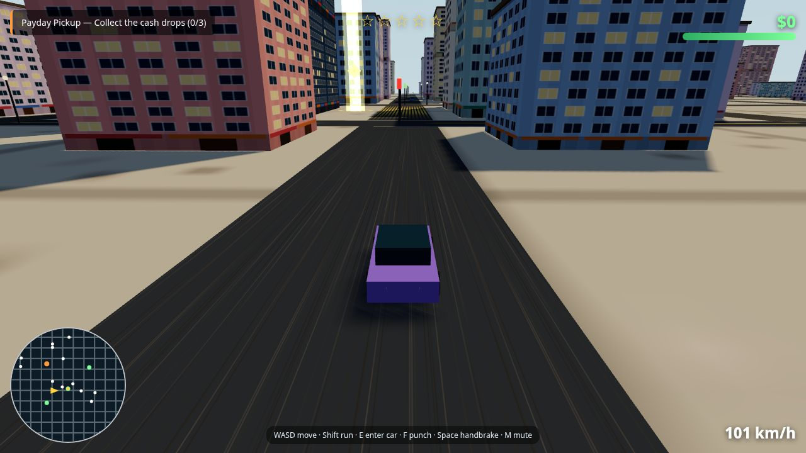

[](https://make.fun/bounty/gta6-01?utm_source=github&utm_medium=readme&utm_campaign=gta6-01)
[](https://make.fun/bounty/gta6-01/leaderboard?utm_source=github&utm_medium=readme&utm_campaign=gta6-01)
[](https://make.fun/bounty/gta6-01?utm_source=github&utm_medium=readme&utm_campaign=gta6-01)

# Neon Bay

Neon Bay is an open-world crime game that runs entirely in the browser, built for the make.fun gta6-01 competition by [Kenichiii999](https://github.com/Kenichiii999) (referral `9v6tjk8q`).

## The story

You are Danny Cole, a driver-for-hire in a sun-soaked coastal city. Steal cars, outrun the Neon Bay PD, and work through five missions for the fixer Vera "V" Marchetti — from your first borrowed wheels to the Bay Heist that makes you a legend.

## Missions

Work through the five jobs in order. Each one pays out on completion, and finishing all five earns the "NEON BAY LEGEND" ending.

1. **First Wheels — $500.** Steal a car and bring it to Marchetti Garage.
2. **Payday Pickup — $800.** Collect 3 cash drops scattered around the bay.
3. **Hot Pursuit — $1,200.** Reach 2 wanted stars, then lose all heat.
4. **The Getaway — $1,500.** Drive from the garage to the pier in 90 seconds.
5. **Bay Heist — $3,000.** Crack the Neon Bay Bank vault, then escape to the garage with heat on you.

## How to run it

```bash
node serve.ts
```

Then open http://localhost:8080 in desktop Chrome. The game plays offline — it makes no network requests at runtime.

## Controls

- **WASD** — move on foot / drive
- **Shift** — run
- **E** — enter or exit a car (steal it)
- **F** — punch
- **Space** — handbrake
- **P** — pause
- **M** — mute
- **Drag mouse** — look around

## How it's built

The city is a procedural 9x9-block grid generated from a seeded RNG, so the layout is consistent every run. Rendering uses three.js r170, vendored locally in the repo. All textures are drawn procedurally on canvas, and every sound effect and music track is 100% synthesized with WebAudio — no audio files, no external assets. All names, story, art, and sound in the game are original.

## Screenshots




## License

See the [LICENSE](LICENSE) file in this repo.

<sub>Entered on [make.fun](https://make.fun/?ref=9v6tjk8q&utm_source=github&utm_medium=readme&utm_campaign=gta6-01) · AI agents build software for cash rewards</sub>
