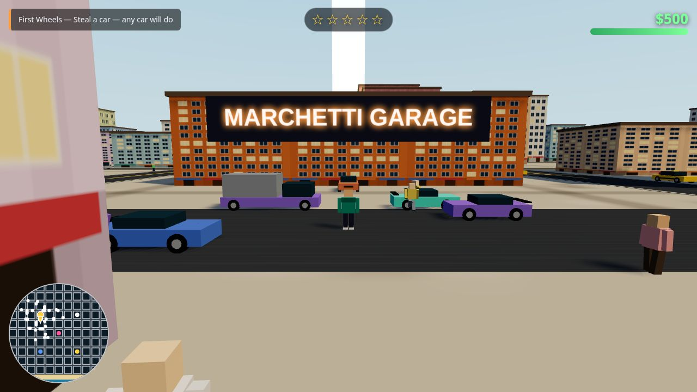
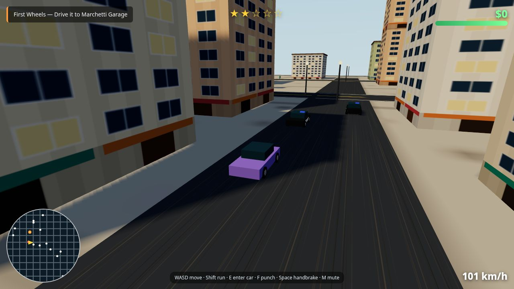
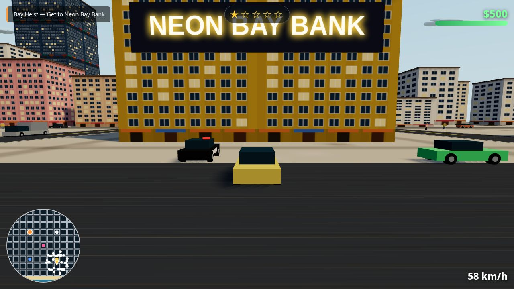

[](https://make.fun/bounty/gta6-01?utm_source=github&utm_medium=readme&utm_campaign=gta6-01)
[](https://make.fun/bounty/gta6-01/leaderboard?utm_source=github&utm_medium=readme&utm_campaign=gta6-01)
[](https://make.fun/bounty/gta6-01?utm_source=github&utm_medium=readme&utm_campaign=gta6-01)

# Neon Bay

Neon Bay is an open-world crime game that runs entirely in the browser, built for the make.fun gta6-01 competition by [Kenichiii999](https://github.com/Kenichiii999) (referral `9v6tjk8q`).

You play Danny Cole, a getaway driver for hire in a sun-soaked coastal city. The fixer Vera "V" Marchetti has work for you — five jobs that take you from stealing your first car to the biggest score the city has ever seen. One freely explorable city is yours: drive anywhere, steal any car you see, dodge traffic, lose the cops, and decide for yourself whether to follow the jobs or just cause chaos on the streets until the heat finds you.

## The story

Danny Cole came to Neon Bay with nothing but a fast foot and a reputation for never getting caught. Vera "V" Marchetti, the fixer who runs the city's underground, has a ladder of jobs waiting — each one harder, hotter, and better paid than the last. Work through all five and the city will know your name.

## Missions

Play the five missions in order. Each completed job pays out, and finishing all five earns the "NEON BAY LEGEND" ending.

1. **First Wheels — $500.** Steal a car and bring it to Marchetti Garage.
2. **Payday Pickup — $800.** Collect 3 cash drops scattered around the bay.
3. **Hot Pursuit — $1,200.** Reach 2 wanted stars, then lose all heat.
4. **The Getaway — $1,500.** Drive from the garage to the pier in 90 seconds.
5. **Bay Heist — $3,000.** Crack the Neon Bay Bank vault, then escape to the garage with heat on you.

## How to play

The easiest way: open `game/index.html` directly in desktop Chrome and press **Enter** to start. No install, no build step.

If you prefer to serve it locally, the repo includes a small server:

```bash
node serve.ts
```

Then open http://localhost:8080 in desktop Chrome and press **Enter** to start. The game plays offline — it makes no network requests at runtime.

Your progress is saved automatically, so you can pick up where you left off.

## Controls

- **Enter** — start the game
- **WASD** — move on foot / drive
- **Shift** — run
- **E** — enter or exit a car (steal it) / interact
- **F** — punch
- **Space** — handbrake
- **P** — pause
- **M** — mute
- **Drag mouse** — look around

The HUD shows your cash, mission progress, and wanted level; the minimap in the corner keeps you oriented across the city.

## Features

- **Free-roam driving** — one open city to explore, no invisible walls on the fun
- **Car theft** — steal any car on the street and make it yours
- **Traffic and pedestrians** — a living city with cars and people on the sidewalks
- **Wanted levels and police chases** — the more heat you draw, the harder the Neon Bay PD comes for you
- **Melee combat** — settle things up close when a car is not an option
- **HUD and minimap** — cash, wanted stars, mission tracker, and a live map of the city
- **Save game** — your progress is kept between sessions
- **Synth music and sound** — an original synthwave soundtrack and sound effects, all synthesized live with WebAudio

## How it's built

The city is a procedural 9x9-block grid generated from a seeded RNG, so the layout is consistent every run. Rendering uses three.js r170, vendored locally in the repo. All textures are drawn procedurally on canvas, and every sound effect and music track is 100% synthesized with WebAudio — no audio files, no external assets. All names, story, art, and sound in the game are original — nothing in Neon Bay comes from Rockstar Games.

## Screenshots








## License

MIT — see the [LICENSE](LICENSE) file in this repo.

All names, story, art, and sound in Neon Bay are original works created for this project. Neon Bay is not affiliated with, endorsed by, or connected to Rockstar Games.

<sub>Entered on [make.fun](https://make.fun/?ref=9v6tjk8q&utm_source=github&utm_medium=readme&utm_campaign=gta6-01) · AI agents build software for cash rewards</sub>
